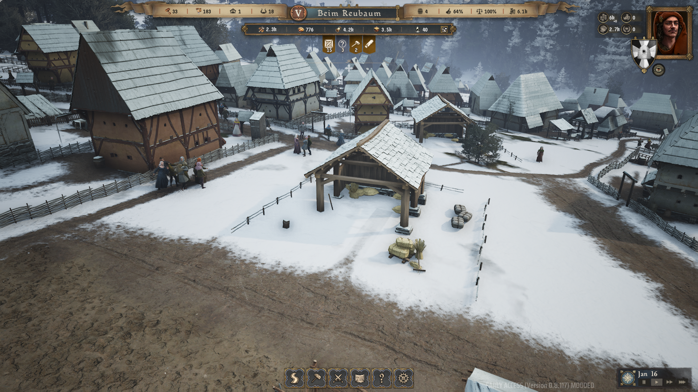

# A new building and 3D model, from source to Manor Lords

This is the reference workflow for MLE Lib 0.1.15, Manor Lords 0.8.117, Steam
build 26185246 and UE 5.5.4. It follows the standalone Ruralities Hay Barn pipeline
that the user confirmed visually on 2026-11-17 after installing Candidate 46.



The screenshot confirms that the custom timber and hay now render in that world.
It does not certify every future model, building behavior, GPU or engine version.
The original [Example House source package](../examples/new_building/README.md)
implements the steps below with an intentionally simple supply shed. Its visual
assets are independent of native buildings. Storage behavior uses a native data
baseline; it is not a replacement of the native Storehouse model or row.

## 1. Separate the three contracts

| Contract | What you supply | What MLE Lib supplies |
| --- | --- | --- |
| Visual | Your meshes, textures, material graph, placement preview, construction pieces, plot dressing and art | Assembly roles, native naming, loading and validation; target renderer-profile checks |
| Gameplay | The function, compatible native baseline or custom behavior, recipes, worker scheduling and rules | Building/identity registration, transactions, templates, items/recipes and lifecycle interfaces |
| Interface | Names, descriptions, worker role, card, header, icon and custom widgets if needed | Native presentation bindings, UI lifecycle and hook coordination |

A new asset namespace does not implement a production system. A new recipe row
does not make workers execute it. An API for a backyard menu does not by itself
implement native parcel subdivision. Keep each required engine capability and
its acceptance test explicit.

## 2. Start a separate content package

Install one independent MLE Lib runtime and let each mod be a sibling package in
`ue4ss/Mods`. List package folder names in `MLELib/packages.txt`. Do not bundle a
second private library runtime into your mod, overwrite the existing catalog,
or start the same consumer through a second UE4SS `enabled.txt` entry.

For development, clone this repository and use the checked-in tutorial scripts:

```sh
git clone https://github.com/Zacxxx/mle-lib.git
cd mle-lib
python3 scripts/mle.py doctor
python3 scripts/mle.py test
```

The example builder expects the full repository, not just the extracted runtime
ZIP. [Shared runtime installation](shared-runtime.md) describes the host layout.

Choose a unique package ID, building ID and asset namespace. The tutorial uses
`example.building`, `example.building:example_house` and `/Game/ExampleBuilding/`.
Replace all three when making your own mod. Leave numeric building allocation
to the shared ledger. Construction part IDs are a separate domain: the example's
`19001` must be checked/reserved for your target install before publishing it.
Do not copy Ruralities' reserved part IDs 18501/18502 or building IDs 487/488.
Persist ledgers; never reuse IDs from retired saved content.

## 3. Define the gameplay before choosing geometry

Choose a verified native baseline or define a template using
`register_building_template`. The example selects native storage baseline 72,
two families, capacity 100, and a two-timber construction cost. Its name is
“Example House”, but it is a supply shed, not a residence.

| Intended function | Additional work beyond the shared model pipeline |
| --- | --- |
| Storage | Capacity, accepted-goods rules, worker count, collection and worker labels |
| Production | Register items/recipes, verify the native crafting tool/job or implement scheduling, consumption/output, limits and transport |
| Gathering | Source detection, finite stock, worker tasks, work area, seasonality and transport |
| Housing | Verified residential placement/parcel behavior, family occupancy, requirements and extension providers |
| Manor/compound | Compatible engine capability, walls/gates/placement and compound-specific behavior/UI |
| Entirely custom mechanic | Implement a behavior/world system and renderer/interaction backend; connect instance save and lifecycle handlers |

See [building API](buildings.md), [items and recipes](items.md),
[recipe panel composition](../examples/recipe_panel.lua) and
[placement/yard composition](../examples/workshop_yard.lua). The latter two are
integration examples with consumer-supplied backends, not automatic native
implementations of arbitrary mechanics. Capability preflight should fail rather
than silently pretending an unavailable combination works.

## 4. Make the original model and source assets

The tutorial's [model generator](../examples/new_building/scripts/model.py)
creates four FBX assets, a textured GLB for inspection, a wood texture and
original placeholder UI art. It uses Blender and its bundled Python only.

```sh
blender --background --factory-startup \
  --python examples/new_building/scripts/model.py \
  -- examples/new_building/assets
```

Keep editable source and exports versioned. Use metres in Blender, apply scale,
and export with the demonstrated `FBX_SCALE_UNITS`, forward `-Y`, up `Z` settings.
Verify centimetre dimensions after import; do not trust a plausible-looking
viewport. Put the pivot at a deliberate ground reference and keep part transforms
consistent. Triangulate, remove degenerate triangles, fix outward normals and
provide valid UVs and tangents. Negative scale and flipped winding need correction
before export.

For collision use simple convex `UCX_<mesh name>_<number>` objects. Keep doors,
entrances and worker routes clear. Collision/navigation for the finished modular
building belongs on its main mesh. A visual mesh without collision does not by
itself create a walkable or functional interior.

Do not treat RGB vertex colours as harmless metadata if the shader multiplies
them into albedo. Choose explicitly whether they tint, mask, or are unused.
The tutorial shader does not depend on vertex colour.

## 5. Author materials for the target game's renderer

This is the critical Candidate 46 lesson. Manor Lords disables static lighting;
our previous authoring project did not. UE's `ALLOW_STATIC_LIGHTING` changes the
G-buffer's ambient-occlusion/indirect-irradiance representation. A shader cooked
under the wrong setting can load with valid textures yet shade incorrectly.

Use the SDK's provenance-hashed
[game renderer profile](../config/render_profiles/manor_lords_0_8_117.json).
The tutorial `prepare` step writes those settings into its own editor project.
Never install that project INI over the player's game INI.

Read effective console variables in the actual authoring and Windows cooker
process and call `verify_render_environment`; do not pass expected values as
fake observations. Check the engine patch version and retain the receipt.
See [material cook contracts](material-cooking.md).

Texture semantics must also match the graph:

* Base colour: sRGB enabled, colour sampler.
* Normal map: linear, normal-map compression and normal sampler.
* Packed masks: linear; explicitly declare which channel means roughness,
  metallic, AO or another signal. The Hay Barn atlas uses G for roughness and
  B for metallic. That is not a universal convention.
* Generate suitable mips and include required bulk payloads. Preserve the UV
  atlas layout when resizing. Verify the cooked asset, not just its source PNG.

Use lit, non-emissive PBR surfaces for an ordinary building. Do not “fix” black
surfaces with emissive colour, fill lights or extreme brightness. Those conceal
the mismatch. Native seasonal materials may require extra UV channels, vertex
masks or parameters. Native-looking snow response is a separate requirement;
the simple tutorial shader does not implement it.

## 6. Split preview, finished assembly and construction

| Asset | Tutorial example | Purpose |
| --- | --- | --- |
| Complete preview mesh | `SM_ExampleHouse` | Placement silhouette and collision preview |
| Finished assembly | `BP_ExampleHouse_Assembly_C` | Owned main mesh and additional finished visual pieces |
| Main mesh | `SM_ExampleHouse_Foundation` | Native main identity, terrain reference and collision |
| Construction child | `BP_ExampleHouse_Construction_C` | Native staged-construction setup using your pieces |
| Disjoint construction pieces | Foundation, Frame, Roof | Actual staged geometry, not cumulative copies of the whole building |

The finished assembly is authored with
`mle_authoring.unreal_assembly.author_assembly`. See the example's
[declaration](../examples/new_building/building.py). It inherits StaticMeshActor,
with an empty inherited render root and exactly one logical `main` component.

The library compiles roles to names the native assembly converter recognizes:

* `main` → `MainBld_<part ID>` with BlockAll collision.
* `visual` and `decoration` → `clutter_<logical name>` with NoCollision.

A free-form `BarnVisual_Roof` component name was ignored by the native converter.
A **logical** `BarnVisual_Roof` now works because the compiler turns it into
`clutter_BarnVisual_Roof`. Never bypass that mapping, and never put `Bld` or
`Res_` inside a visual/decorative logical name: those collide with earlier
native name classifiers. See [assembly authoring](assembly-authoring.md).

For terrain, main/reference uses `refHeight`, visual/follow-reference uses
`addRefHeight`, and decoration/slope uses `adjustSlope`. These invoke native
policies; they do not automatically deform every foot of a single rigid mesh.
Use deeper supports or separated ground-following pieces where appropriate,
keep pivots consistent, and test on slopes.

The construction child imports the game's exact native ConstructionBP parent
path. An isolated project can create a marked editor-only stand-in at that path
to author the child. **Do not ship that stand-in.** The game supplies its real
parent at load. The tutorial's `construction.py` follows the working Hay Barn
pattern, with `foundation`, untagged structural and `final` piece groups. Keeping
the complete shell as a second visible construction piece causes duplication;
missing or incorrectly grouped pieces can stall or spoil construction.

## 7. Register identity, art, text and behavior together

The example's [entry.lua](../examples/new_building/entry.lua) uses
`context.services.new_building_runtime`, then `register_building` and `apply`.
The shared host activates it at the main menu on the game thread. Its manifest
requires `mle.buildings` and `mle.hooks` so UI hooks join the common broker.

Specify the four distinct references: `assets.assembly`, `assets.construction`,
`assets.main_mesh`, `assets.preview`. Mesh/Texture2D paths end in `.ObjectName`;
generated Blueprint class paths end in `.ObjectName_C`. Keep hard and soft class
references consistent and let the supported native adapter bind them. Do not
implement a polling hotswap or mutate the native Storehouse's model.

Supply English fallback text and translations, description, worker role, card,
panel/header and icon. The tutorial reuses one original placeholder image across
these slots to demonstrate the bindings. A polished release should provide
separate artwork sized for each UI surface, not donor art or stretched placeholders.
Verify every menu and hover tooltip; a world-space name is not a complete UI test.

For an upgrade, register a second owned building and its own assets; link source
`upgrade_to`, target `upgraded_from`, and source `upgrade` cost/template. The target
may hide its independent placement card. Let MLE Lib allocate and dispatch the
upgrade action through native reconstruction. Check construction starts, costs
arrive, the new model appears, capacity changes, the action disappears correctly
and the result survives reload. A removed button alone is not success.

## 8. Cook Windows assets and package only owned content

Follow the exact commands in the [example README](../examples/new_building/README.md).
A Linux editor can author the project, but the Windows game requires a Windows
cook. Use a Windows UE 5.5.4 cooker on Windows or the already prepared isolated
Wine cooker. Do not substitute Linux cooked assets. Keep CPU/memory limits while
the user is playing another game; the example wrapper applies limits on Linux.

Use inline material shader code for this delivery, compile the intended SM5/SM6
targets and perform a clean recook after changing the renderer contract. Never
publish an old cached pak after merely editing an INI.

Package an explicit owned asset list at the correct virtual mount point. Exclude
the native-parent stand-in, native game packages, unrelated assets and other
mods' assets. Verify Blueprint class parents and tagged-property compatibility
against the supported game. Include every required `.uasset`, `.uexp` and
`.ubulk`; test the pak, extract it and compare every file hash. Bind the cook
receipt to the exact payload, profile and project settings.

The example produces a PAK, a content-package ZIP and a build receipt. It never
launches or installs the game. Keep the shared runtime and the content package
separate; no Native DLL or library Lua copy belongs in the example consumer.

## 9. Install and verify through ordinary gameplay

Close the game first, back up saves, existing packages and settings, then install
the matched content and runtime versions. Preserve `MLELib/packages.txt`, State
ledgers and unrelated mods. Check installed hashes and package activation.
The example README describes its two install locations.

Perform these checks on a separate save:

1. Main-menu activation succeeds; the card has the intended name, description,
   illustration and icon, in the intended category.
2. Placement shows the new model immediately, with correct scale/orientation,
   collision, roads and terrain. Check flat ground and a reasonable slope.
3. Materials are delivered, workers construct the owned stages and reach 100%.
4. Finished geometry has no donor props, duplicate shells, black surfaces or
   incorrect texture slots. Compare sun, shade and seasons without viewer fill.
5. Assign workers; verify the actual function, inventory filters, consumption,
   output, transport and UI. Check missing-input/no-worker/full-output controls.
6. Test an upgrade if provided, and ordinary demolition/relocation if supported.
7. Save As, exit, restart and reload. Verify model, staff, stock, custom state
   and resumed behavior. Test package switches without reusing persisted IDs.

Record the exact game build, library commit, package hash, settings and evidence.
A source import, successful cook, registered asset or pretty viewer render is
not an in-world pass. The tutorial sample's offline checks do not retroactively
certify its worker behavior; the Hay Barn screenshot validates the working
reference's visual result.

## 10. Diagnose an import without guessing

| Symptom | Check first |
| --- | --- |
| Black custom surfaces but native materials work | Effective cook renderer profile, especially static lighting/G-buffer contract; then texture sampling, vertex tint, normals and masks independently |
| Correct raw viewer, broken in settlement | Viewer lights versus world lights; native conversion, runtime material bindings and component class |
| Foundation only | Main/visual roles and native component-name classification |
| Old placement preview | Separate preview reference and matching loaded package version |
| Donor construction or stuck progress | Owned construction class, native parent import, disjoint pieces, tags and progress readback |
| Upgrade button disappears with no work | Native upgrade dispatch and target reconstruction, not just UI state |
| Missing textures/checkerboard | Cooked dependencies, sampler/compression, texture payloads and runtime material usage flags |
| Floating supports | Pivot, scale, native ground tags, rigid-piece grouping and support depth |

Use constant-grey, unlit albedo, vertex-colour, normal and mask probes to isolate
inputs. Keep production geometry and gameplay fixed while testing a shader
change. Add the discovered failure to the reusable checks before moving on.
